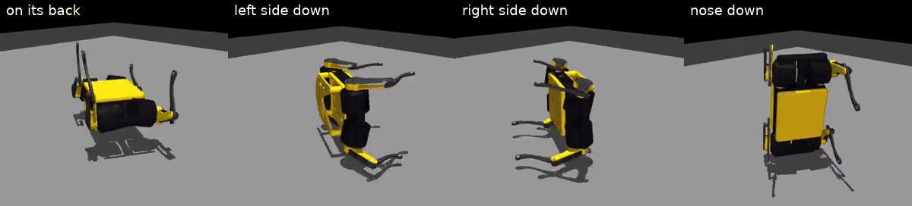
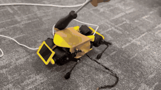
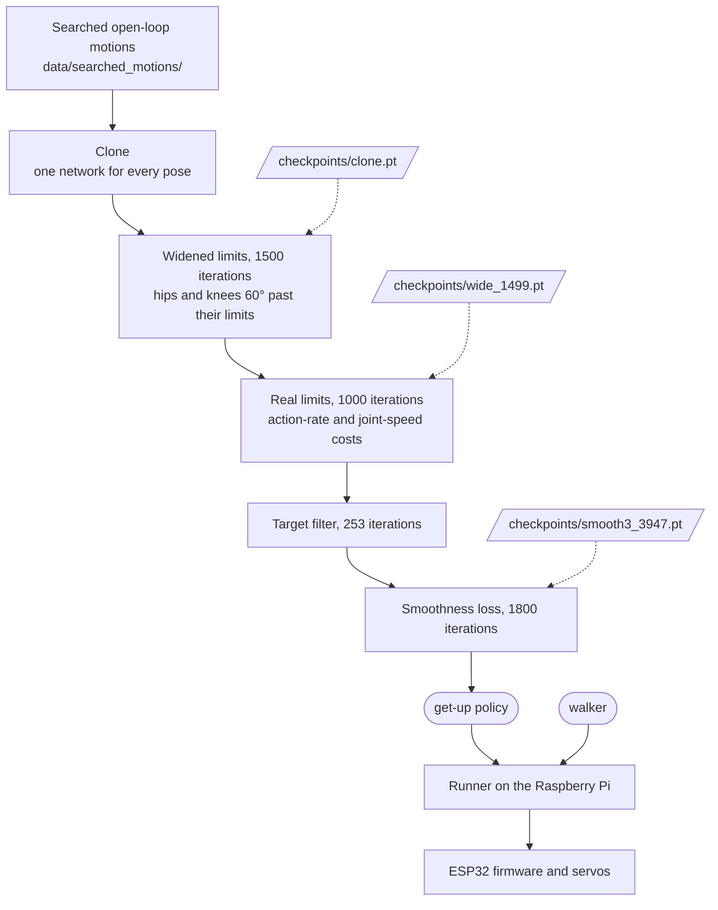
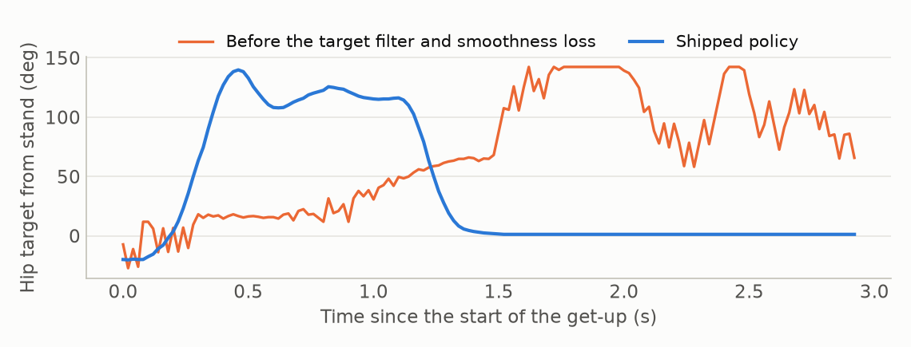
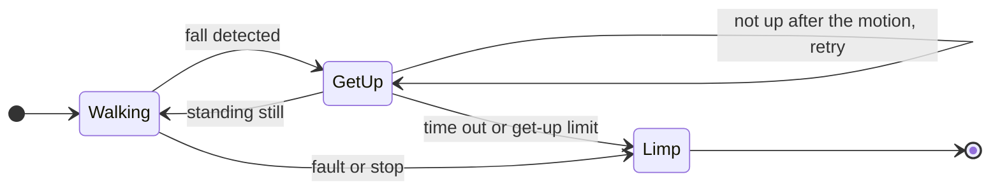

# mini_pupper_4_recovery

Fall recovery for the Mini Pupper v4 (SKU2): rides out shoves, gets up from the falls tested so far, and walks on. This repository has
the get-up training recipe, the evaluation, the program that runs on the robot, and the trained policies.

<p align="center">
  
</p>
<p align="center">
  
</p>

## Policies

| Policy | What it does | Inputs | How it was made | Tested on |
|---|---|---|---|---|
| `policies/walker` | Stands, walks in every direction, climbs stairs, rides out shoves | 450 (10 frames × 45) | Fixed weights; the abductions' stand is 12° wider, which is what handles shoves | Robot (standing, 0.10 m/s forward) and simulation |
| `policies/getup` | Gets up from the fall poses tested so far | 45 | Training recipe's steps, an earlier run | **Robot** and simulation |
| `policies/getup_sim` | The same job, from the recipe as shipped (seed 41) | 45 | The training recipe | Simulation only |

The two networks run separately. A program on the Raspberry Pi switches to the get-up on a detected fall and back to
the walker once the robot stands.

## How the pieces fit



Dashed arrows are shortcuts: `START=checkpoints/clone.pt sh scripts/recipes/getup.sh` starts at the widened limits,
`START=checkpoints/wide_1499.pt` at the real limits, and `START=checkpoints/smooth3_3947.pt` at the last 600 iterations of the
smoothness loss.

Training directly inside the joint limits never learns to flip from the back, so the first step widens them. A target
filter added to a trained policy breaks it, so the policy trains under the filter. Together, the filter and the
smoothness loss remove fast target reversals in the air:

<p align="center">
  
</p>

## On the robot



The robot needs the [servo-link firmware](docs/ROBOT.md#firmware) with its get-up mode.

## Quick start

```bash
git clone <this repository> && cd mini_pupper_4_recovery
bash scripts/install/install.sh                       # 15-45 min, about 6.5 GB; see docs/INSTALL.md
# Evaluation and training need an NVIDIA GPU; without one the installer picks CPU mode.
.venv/bin/python -m pytest tests/cpu                  # about 5 min, no GPU needed

# Evaluate a get-up from every start (about 5 min)
.venv/bin/python -m mp4_recovery.eval.getup_eval --policy policies/getup --seed 12 --robots 256 --seconds 8 \
  --starts left,right,nose,back,midfall,crouch,random --motion --json runs/eval/getup.json

# The full sequence: walk, shove, fall, get up, walk, for 60 s (about 6 min)
.venv/bin/python -m mp4_recovery.eval.sequence --walker policies/walker --getup policies/getup \
  --schedule 0.5 1.5 2 4 --robots 256 --seconds 60 --seed 12 --getup-phase-restart 1.0 --json runs/eval/sequence.json

# Train the get-up: about 12 h on an RTX 5080
sh scripts/recipes/getup.sh

# Put the policies on a Raspberry Pi and run them: see docs/ROBOT.md
tools/deploy.sh user@pi walk   # walk: the folder on the Pi
```

The result of a training run depends on its random seed. Compare runs with the sequence evaluation: it separates them
better than success from a placed pose.

## Results

**Simulation.** 256 robots, the commands above with seeds 12 and 13 for the get-up, 12 and 15 for the sequence. The
sequence kicks each robot at 0.5–1.5 m/s from any direction every 2–4 s.

| | `policies/getup` | `policies/getup_sim` |
|---|---|---|
| Get-up success, every start | 99.2–100 % | 99.2–100 % |
| Walking again within 8 s of a fall | 89.9, 84.7 % | 99.3, 100 % |
| Robots that never got up, of 256 | 17, 26 | 2, 0 |
| Back to walking, 90th percentile | 7.4, 7.6 s | 2.0, 2.1 s |

The evaluation differs by 1–3 points between identical runs. Get-up success starts from placed poses with nothing else
happening; walking again is measured in the sequence, where kicks keep landing during a recovery and there is a time limit.

**The walker** in simulation (seed 12):

| Check | Result |
|---|---|
| Shoves standing, falls at 0.75 / 1.0 / 1.25 / 1.5 m/s | 0 / 2.1 / 12.3 / 16.0 % |
| Shoves walking, falls at 0.75 / 1.0 / 1.25 / 1.5 m/s | 0 / 0.9 / 13.3 / 23.7 % |
| 20 walking and turning commands | no falls |
| Four 25 mm stairs / eight 25 mm stairs | 98.8 / 95.7 % reach the top |
| Rough ground, eight kinds, 256 trials | 96.5 % (box obstacles 87.9 %, raised relief 86.7 %) |

**One real robot, by hand** with `policies/getup` and `policies/walker`. `tools/summarise_runs.py` makes this table from a
robot's run logs:

| | Get-ups | Up first time | Retried | Run ended first | Never rose |
|---|---|---|---|---|---|
| Placed: back, either side, nose down | 8 | 7 | 1 | 0 | 0 |
| Falls from hand shoves | 19 | 15 | 0 | 3 | 1 |

Median time to walking was 2.1 s after a fall, with current peaks up to 3.15 A.

## Known limits

- **Everything was developed on one robot.** The joint limits, calibration and IMU mounting are its own. See
  [Adapting to another unit](docs/ROBOT.md#adapting-to-another-unit).

## What is where

```
policies/          the shipped policies
checkpoints/       training states to start a recipe step from
data/              searched motions, stair layouts
scripts/           installer, get-up and walker recipes
src/mp4_recovery/
  gpu/             training: get-up task, PPO with the smoothness loss, cloning, motion search
  eval/            get-up, full sequence, thresholds, shoves, walking, terrain
  deploy/          the runner and the serial link; numpy and pyserial only
  export_policy.py checkpoint to policy
  robot/, actuators/  the robot model and the fitted servo model
tools/             deploy, stop, stream playback, contract for another unit, run summaries, robot-versus-simulation
tests/             cpu/ needs no GPU, gpu/ 5-15 min
docs/              INSTALL, TRAINING, ROBOT, POLICY_CONTRACT
```
