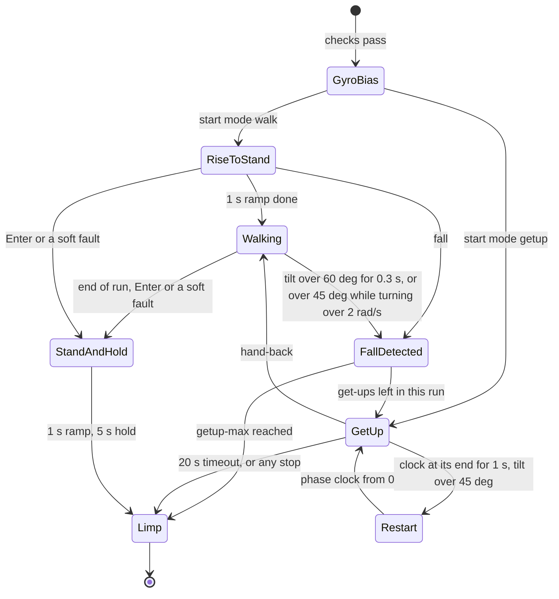

# Running on the robot

Two policies run together on a Mini Pupper v4 SKU2 (the long body with a Raspberry Pi 5). The **walker**
(`policies/walker`) stands, walks and rides out shoves. The **get-up** (`policies/getup`) takes over when the runner detects
a fall, and hands back once the robot stands: the walk, shove, fall, get-up, walk sequence.

The shipped contract and policies belong to one calibrated robot. On any other unit, go through
[Adapting to another unit](#adapting-to-another-unit) first. All results below come from that one unit, shoved by hand.

## Requirements

- Mini Pupper v4 SKU2, with the hood on (the simulated body includes it).
- The servo-link firmware with the get-up mode: see [Firmware](#firmware).
- Raspberry Pi 5 with Python 3.10 or newer, numpy and pyserial (`sudo apt install python3-numpy python3-serial`). Nothing else
  is installed on the Pi. Tested with numpy 2.4.3.
- The Pi's UART: `dtparam=uart0=on` in `/boot/firmware/config.txt`, no serial console on `ttyAMA0`, your user in `dialout`.
- On the workstation: `ssh` and `rsync`.
- A hand ready, and a foam mat for floor falls.

## Firmware

Flash the `mini-pupper-4-getup` branch of [the firmware repository](https://github.com/ugsfume/mini_pupper_4_recovery_firmware) onto the ESP32-S3, with ESP-IDF 5.5:

```sh
idf.py build
idf.py -p PORT flash
```

Flashing keeps the calibration offsets. The official firmware can't run this: it stands the robot up by itself 2 s after the
last frame and stops at 500 mA, and the runner goes limp when the firmware doesn't echo the get-up mode.

What the firmware does on its own:

| Guard | Limit | Result |
|---|---|---|
| Link watchdog | no frame for 100 ms | every servo idle |
| Current, walking | any driven servo above 1.5 A for 0.5 s | every servo idle, latched |
| Current, get-up mode | **none** | see [No current guard in get-up mode](#no-current-guard-in-get-up-mode) |
| Housing temperature, both modes | above 60 °C for 1 s | every servo idle, latched |
| Servo board | silent for 100 ms | every servo idle, latched |

## Deploying

From the workstation, at the repository root:

```sh
tools/deploy.sh ubuntu@PI walk
```

This copies the runner, the contract, the policies and any `runs/streams/` into `~/walk` on the Pi, and runs `runner check` on each policy there;
a failed check prints `FAIL` or `DIFFERS` and stops the script. Redeploy after changing a contract or a policy.

## Start-up checks

After every power-up, battery swap or Pi reboot.

**Power order:** the ESP32 board first, then the Pi. If the Pi has its own supply, don't cycle the board alone with the Pi on.
If `ping` says `IMU ABSENT`: Pi off (`sudo poweroff`, then unplug), board off, USB unplugged, 10 s, board on, then Pi.

```sh
ssh -t ubuntu@PI                    # -t: Enter, the graceful stop, needs a terminal
cd ~/walk
M="env PYTHONPATH=src python3 -B -m mp4_recovery.deploy.mp4link"
R="env PYTHONPATH=src python3 -B -m mp4_recovery.deploy.runner"
fuser /dev/ttyAMA0                  # must print nothing: nothing else holds the link
$M ping --seconds 2                 # STATE at about 200 Hz, 0 CRC errors, IMU ok, four boards fresh
vcgencmd get_throttled              # 0x0 is good; 0x50005 is under-voltage right now
```

No STATE means other firmware: stop.

**The calibration**, once per session and whenever someone else has used the robot:

```sh
$M offsets --json /tmp/offsets.json
python3 -c "
import json
a = json.load(open('/tmp/offsets.json'))['offsets_deg']
c = json.load(open('src/mp4_recovery/data/sku2_contract.json'))['offsets_deg']
print('offsets ok' if a == c else 'MISMATCH')"
$M config                           # the servo gains, which every power-off of the servos loses; calib needs them
$M calib --seconds 20               # holds the stand 20 s at 300 mA, saves nothing: look for left/right symmetry
```

A mismatch or a wrong-looking stand means someone recalibrated or re-horned a joint: sort that out first. The runner only warns
about a mismatch at start-up, so this look at the stand matters.

## Lifted playback

Do this before floor get-ups on a new robot or with a new policy. Put the robot on a block, or hold it, with every leg free. The
motions come from the simulated get-up, about a minute per start on the workstation (`gpu` install, no GPU needed):

```sh
python tools/getup_stream.py --policy policies/getup         # back, left, right, nose at 25 % and full speed, in runs/streams/
tools/deploy.sh ubuntu@PI walk                               # copies runs/streams/ too
```

For another policy, `--policy policies/getup_sim`: the files start with the policy's folder name.

Then on the Pi, after the start-up checks, one file at a time, each start at 25 % before full speed:

```sh
$M config                           # the servo gains
$M stream runs/streams/getup_back_s14_x0p25.npz --cap 600 --log logs/lifted_back_x0p25
$M stream runs/streams/getup_back_s14_x1p00.npz --cap 2000 --log logs/lifted_back_x1p00
```

Each one ramps from where the legs are to the first pose in 2 s, holds 1 s, plays, ramps back to the stand in 1 s, holds 1 s and goes
limp. It runs in the firmware's get-up mode, so **there's no current guard**. It refuses a file with a target near a track end, and stops
and returns to the stand if a joint reads within 15° of one, a housing holds 55 °C for 1 s, or the firmware doesn't echo the get-up mode.

Watch for a leg hitting the body or another leg, a joint moving the wrong way or lagging far behind the others, and any grinding or
clicking from an abduction. **Enter** stops and returns to the stand; Ctrl-C goes limp at once. Stop for good if you see any of these,
and sort out the cause before a floor get-up.

The summary should say `stream completed`, with 0 targets clipped (a frame or two from tick rounding is fine) and the get-up mode echoed on
100 % of frames. Check the abductions by hand, and the temperature between files (`$M ping --seconds 1 | grep "max temp"`). Then start floor
get-ups with `--getup-max 1`.

## Launching

```sh
# Get up from a pose you placed it in, then stand briefly
$R run --start-mode getup --getup-max 1 --seconds 8 --log logs/up1

# Stand in place and take shoves
$R run --seconds 40 --log logs/shove1

# Walk and take shoves: at 0.10 m/s, 15 s is about 1.5 m
$R run --vx 0.10 --seconds 15 --log logs/walk1
```

Sideways is `--vy 0.05`, turning is `--wz 0.5`. Use a new log name each time.

**Hands off, and the robot still, for the first second of every run:** the runner measures the gyro's bias then.

- **Sequence:** 1 s of gyro calibration, 1 s rising to the stand, then the walker. With `--start-mode getup` there's no rise: the
  get-up starts straight away.
- **Where the walker heads:** it holds the direction it faced at launch. Aim it first. If you turn it by hand, it steers back.
  `--no-heading-loop` turns this off.
- **`--seconds`** is the policy loop's length, get-ups included. At its end the robot ramps to the stand, holds 5 s and goes limp
  (the body drops about 7 cm). If the time runs out during a get-up, it goes limp at once, so leave a margin: a 20 s run with a
  fall at 18.6 s dropped mid-flip.
- **`--getup-max`** (default 10): get-ups allowed in one run; the next fall goes limp.
- **`--getup-timeout`** (default 20 s): not up after this long in one get-up, limp.
- **`--getup-phase-restart`** (default 1 s): the retry. Leave it on: at 0, a missed first attempt never tries again.
- **`--getup-policy policies/getup_sim`** uses a newer get-up in place of `policies/getup`. It has been tested in simulation only,
  never on a robot: do a [lifted playback](#lifted-playback) first.

The logs go to `<log>.npz` (every frame), `<log>.policy.npz` (every policy step and get-up) and `<log>.stand.json`. They're
written only at the end of a run, so run `sync` on the Pi after one you care about. Copied to the workstation, a folder of them
is summarised by `python tools/summarise_runs.py logs`.

### What the runner does



- **Hand-back:** tilt under 12°, gyro under 0.8 rad/s and the pose within 10° rms of the stand, all held for 25 steps (0.5 s).
- **Soft faults:** an invalid IMU frame, a non-finite action, a gap in the STATE frames, two late steps in a row, a servo at 55 °C
  for 1 s.
- **Limp at once, from any state:** Ctrl-C, a link fault or firmware guard, a target that fails its check, no get-up echo from
  the firmware for 0.2 s.

### Refusals before arming

A latched fault, a servo gain that doesn't read back, no valid IMU, a servo at 45 °C or more, a joint reading within 10° of a
potentiometer track end (`implausible positions`: move that leg by hand and launch again), and a policy whose bounds were
made for another calibration.

## Placing it

For `--start-mode getup`:

| Pose | How | What it does |
|---|---|---|
| On its back | Belly up, legs up | Flips over, lands, stands: 2.0–2.8 s |
| Left side down | On its left flank | Pushes straight up: about 1.2 s |
| Right side down | On its right flank | Rolls onto its back first, then pushes up with its right legs: about 2.3 s |
| Nose down | Leaning on its front legs, nose lowest; not stable, so let it settle first | About 1.1 s |

## During and between runs

- **Shoves:** push the body with the flat of your hand or a stick, not the legs, then let it settle. Standing, it rode out about
  14 firm shoves; only a hard one topples it. Keep your hand clear of the legs once it's going over: it starts flipping within about
  0.3 s.
- **Stop before you pick it up.** While a run is on, lifting it can read as a fall: the legs start the get-up in your hands, or with
  `--getup-max 1` it goes limp.
- **Abductions:** feel them by hand for new play or roughness after back flips and after each set of shoves.
- **The Pi's cable:** route it with slack along how the robot moves, with strain relief. It snagged one flip, and a tug on it cut
  the Pi's power once.
- **The IMU is on the ESP32 board:** keep the board in its original mounting. The Pi can sit elsewhere, rigidly fixed, inside the
  body's footprint.

### Temperatures

```sh
$M ping --seconds 1 | grep "max temp"
```

The runner refuses to start at 45 °C and stops at 55 °C held for 1 s (limp during a get-up); the firmware cuts out at 60 °C for
1 s. Measured: an 8 s get-up about +1 °C; 40 s of shoves +3 to +4 °C; a 30 s stand about +3 °C (the wider stance loads the
abductions). The front legs run hottest. About 10 minutes limp, or with the servos off, brings it down. A reading can spike for one
frame, to double the real value: check again before worrying.

## Stopping

- **Enter** (in the `ssh -t` terminal): standing or walking, it ramps to the stand, holds, then goes limp. In a get-up, limp at
  once.
- **Ctrl-C**, or `tools/stop.sh ubuntu@PI` from any terminal on the workstation: limp at once, the body drops, the log is saved.
- **The servo power switch** cuts everything.

The firmware's walking current guard and temperature cut-out latch: the next launch is refused until you add `--clear`. Look at
why first. Neither tripped in any logged run.

## No current guard in get-up mode

**Nothing limits or stops the current during a get-up.** The firmware's current guard is off in that mode, because a get-up holds
joints near stall and the walking guard would trip. The frame's 2 A cap doesn't help: in the servos' control mode it only limits
duty, to `min(0.99, 0.001 × 2000)`, so 0.99. The runner prints an advisory above 1.2 A for over 1 s, logs it and carries on. Run peaks
in the logged get-ups were 1.7 to 3.2 A.

So a jammed joint or a snagged leg is driven at full duty until the robot stands, the 20 s timeout ends the get-up, the temperature
stop trips or you stop it.

**The abduction gears are what this puts at risk.** They're the robot's weak part: abduction gear trains on two bench units failed
with a wedging tooth, from the dynamic torque of arresting a heavy load at high gain, and a static torque cap didn't protect
them. A back flip's landing loads them, and nothing measures that on the robot. Expect them to wear, and possibly to break:

- check them by hand after back flips and shoves, and stop if one feels rough or has new play;
- keep a spare servo module on the bench;
- don't let it retry for long. The housing temperature lags: about 5 °C at the housing has been measured against about 40 °C at the
  winding, so repeated attempts heat the motors far more than the temperature stop sees;
- the default budget (`--getup-max 10`, `--getup-timeout 20`) can mean long periods of near-stall drive with no current guard. Use
  `--getup-max 1` while testing a new policy, and check the temperature between runs.

## What to expect

- **Get-ups:** 8 of 8 from placed poses. From shoves, 19 falls: 15 up on the first attempt (median about 2.1 s to the walker), 3 cut
  off by the end of the run, 1 never rose, cause unknown.
- **A retry** starts 5 s after the start of a failed attempt, whenever the attempt failed. One placed get-up needed it, when the
  cable snagged. It's a runner rule, not a learned behaviour.
- **Right legs draw about twice the left's current,** on walking and get-ups alike. The cause isn't known.
- **It can go limp at the walker's first step** with `watchdog` in the message: 2 of 13 launches logged without the runner's
  first-step safeguard. Nothing is wrong with the robot: stand it up and launch again. `tools/first_step_timing.py --starts 10`
  measures that first step on the Pi, without motors; the safeguard has been tested on a fake board only. The tail of the first-step gaps (91–109 ms) is unexplained, so it may not
  cover that.
- **Walking:** only straight ahead at 0.10 m/s has been tried on the robot. In simulation the wider stance lowers success on box
  obstacles.

## Comparing a run with the simulation

`tools/compare_run.py` puts a robot log next to simulated robots on the workstation: `stream LOG.npz --stream FILE.npz --policy DIR` for a
lifted playback, `floor LOG_PREFIX --policy DIR` for a get-up from the floor. Its docstring has the pass criteria and the other modes.

## Adapting to another unit

The contract holds one robot's calibration, and a policy's bounds are measured from that robot's stand. The runner refuses bounds
made for another stand.

**1. Calibrate.** `$M config`, then `$M calib` in an `ssh -t` terminal: it holds the stand, you adjust the offsets with the keys it
lists until the stand looks right, and `s` saves them. Offsets are limited to ±90°. To mount a leg first: `$M centre --ids ID`, and `$M calib --zero ID` afterwards.

**2. Make the contract and re-export both policies' bounds.** On the Pi, `$M offsets --json offsets.json`; copy the file to the
workstation; then, at the repository root with the virtual environment active ([INSTALL.md](INSTALL.md)):

```sh
python tools/make_contract.py offsets.json --note "unit 2" --out src/mp4_recovery/data/sku2_contract.json
python -m mp4_recovery.export_policy --from-policy policies/walker policies/walker_new
python -m mp4_recovery.export_policy --from-policy policies/getup policies/getup_new
python -m mp4_recovery.deploy.runner check --policy policies/walker_new
python -m mp4_recovery.deploy.runner check --policy policies/getup_new
```

The networks don't change. Move the two `_new` folders over `policies/walker` and `policies/getup`, do the same for
`policies/getup_sim`, and deploy. `runner check` says
`exported for an earlier calibration`: that's expected, the policy's recorded contract hash is the replaced one.

Where the stand moved far along a joint's track, the new bounds can cut motions the policy learned. Compare them with the old
ones in each `policy.npz`'s meta, and retrain or re-horn the joint if a range shrank a lot.

**3. Check the IMU's mounting.** The IMU is on the ESP32 board. The servos stay idle during this:

```sh
$R imu --seconds 30
```

It prints gravity under each known mounting. Hold the robot nose down: the right mounting reads x positive. Right side down: y
negative. The shipped mounting is `swap_xy`, named in `src/mp4_recovery/data/imu_mount.json`; change the name
there if another fits, and repeat this check after any change to the board's mounting.

**4. Check the joint limits.** `src/mp4_recovery/data/sku2_joint_limits.json` is one unit's measurement, by hand and under power, and
`make_contract` keeps it. Abduction travel in particular is set by the chassis, 38–45° in total on that unit. Look at your robot's with
`$M watch --seconds 60`, moving the limp legs by hand. If yours are narrower, change the file and re-export; the policies were trained
on the measured ranges, so a large difference means retraining ([TRAINING.md](TRAINING.md)).
